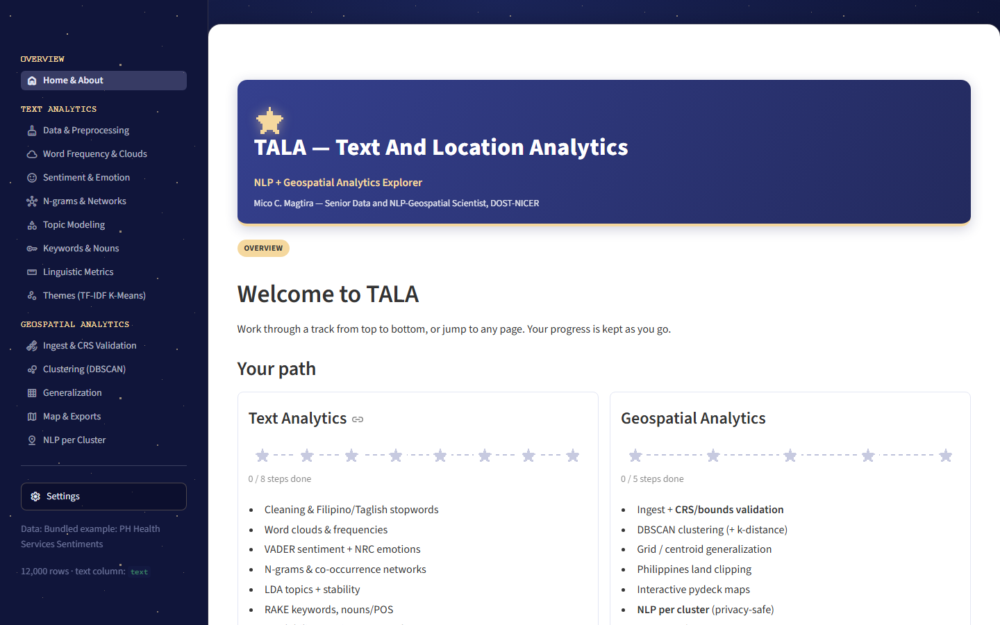
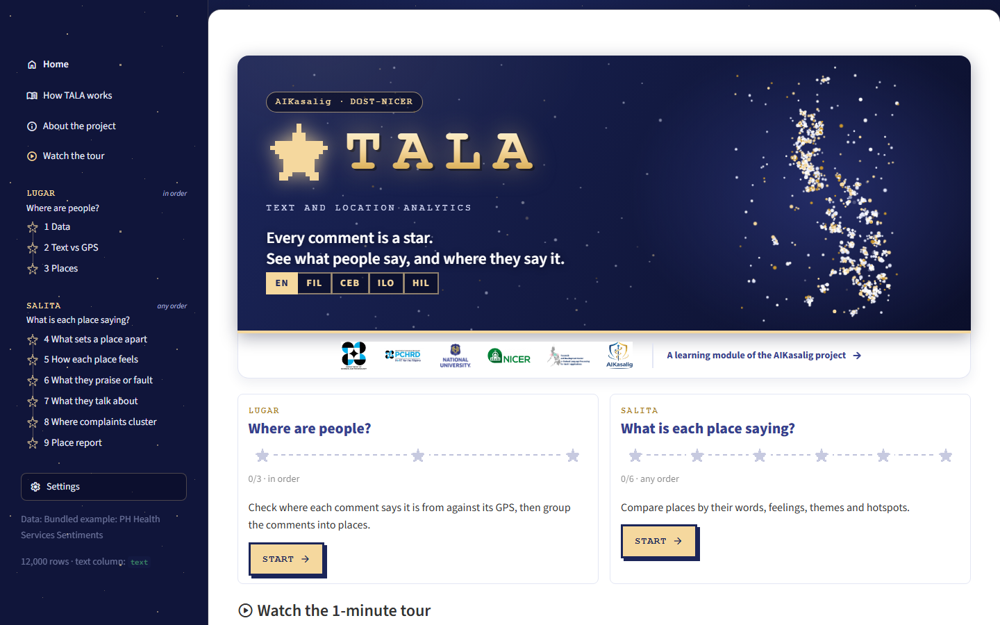

# TALA: Text And Location Analytics

> **Every comment is a star. See what people say, and where they say it.**

TALA is an interactive **NLP + geospatial** learning module of **AIKasalig**, Project 4
of the DOST-NICER **R&D Center on Natural Language Processing for Health Applications**
(RDC-NLPHA) at **National University, Manila**. AIKasalig ("Advancing Responsible AI in
Philippine Healthcare: A Multi-Year NLP-Driven Roadmap for Trust, Transparency, and
Ethical AI", February 2026 to January 2029; Project Leader: Dr. Mideth B. Abisado) builds
a multilingual AI Trust Toolkit in Filipino, Cebuano, Ilocano, Hiligaynon and English.
TALA teaches the text-and-location analytics behind it in the same five languages: it
reads where each comment says it is from, checks that against the GPS, and then compares
what each *place* is saying.

> **TALA** = **T**ext **A**nd **L**ocation **A**nalytics. *Tala* is Filipino for
> *star* and for a *record / note*.
>
> Partners: DOST · DOST-PCHRD · National University · DOST-NICER · NICER RDC-NLPHA ·
> AIKasalig. Developed by **Mico C. Magtira**, Senior Data and NLP-Geospatial Scientist,
> DOST-NICER.

| Before (word-cloud pages, method per tab) | After (place-first) |
|---|---|
|  |  |

More frames are in [`docs/screenshots/`](docs/screenshots/): the loading screen with
the partner logos, the About the project page, Home on a phone, the START meteor wipe,
the constellation sidebar with the "ran for you" notice, Text vs GPS, the place report
and the How TALA works page.

## What it does

TALA is **simple first, with depth on demand**: anyone can follow the journey, and the
collapsed Learn panels and the How TALA works page carry the theory and code for
computer students. One dataset
(`id, text, lon, lat`), nine steps, two chapters. Chapters are named, not translated:
**Lugar** and **Salita**.

### Lugar: Where are people? (in order)

| # | Step | Method |
|---|---|---|
| 1 | **Data** | Load the bundled set or your own CSV/Parquet/XLSX, map columns, preview cleaning, add custom stopwords (plus a Filipino/Taglish stopword toggle). |
| 2 | **Text vs GPS** | Rule-based **geoparsing** against a GeoNames gazetteer (longest title-case match, ambiguous names resolved from a co-mentioned province), then a **haversine** check of the named place against the GPS. Each row is `agree`, `disagree`, `gps_invalid` (out of range or off Philippine land), `no_place` or `ambiguous`; **repair** swaps in the named place's coordinates. |
| 3 | **Places** | Group comments into places: **Region** (from the gazetteer, the readable default) or **Cluster** (DBSCAN with a k-distance elbow). |

### Salita: What is each place saying? (any order)

| # | Step | Method |
|---|---|---|
| 4 | **What sets a place apart** | Contrastive keywords: **weighted log-odds with an informative Dirichlet prior** (Monroe, Colaresi and Quinn 2008), one place vs the rest or vs another place. |
| 5 | **How each place feels** | **VADER** sentiment per place with **Wilson intervals** on % negative; places with too few comments are greyed out with the reason. |
| 6 | **What they praise or fault** | **Aspect lexicon sentiment**: waiting, staff, cost, medicine, facilities, access (English and Filipino terms in `data/aspects.json`), VADER-scored per sentence. |
| 7 | **What they talk about** | **TF-IDF + K-Means** themes with a **silhouette** readout for k, and theme share per place. |
| 8 | **Where complaints cluster** | **Getis-Ord Gi\*** hotspots of negative sentiment on a grid (binary distance band), hot/cold at 90/95/99%. |
| 9 | **Place report** | **Generalized, privacy-safe** map (grid cells or place centroids, small groups hidden), one report card per place, and GeoJSON / CSV / `metadata.json` exports. |

Chapter 2 pages run the Chapter 1 steps they need automatically, with default
settings, so any page can be opened first.

## The deliberate dirty-coordinates lesson

The bundled data is intentionally wrong in places: row 0 says *Cagayan de Oro* but
its GPS sits near London. TALA turns that into the first thing you see. On the
12,000 bundled comments (50 km agreement threshold):

| Result | Rows | Share |
|---|---|---|
| Text and GPS **agree** | 7,201 | 60.0% |
| GPS **disagrees** with the named place | 974 | 8.1% |
| GPS **invalid** (missing, out of range or off land) | 3,752 | 31.3% |
| Place **ambiguous** (e.g. bare "San Fernando") | 73 | 0.6% |

About **39% of the coordinates are wrong**. Place mentions: **11,898 of 12,000
(99.2%) resolve** to a gazetteer entry (the other 102 are ambiguous); 258 distinct
places are named. After **Repair**, 11,971 rows have a usable point (7,274 from the
GPS, 4,697 from the named place).

## Navigation

- **Constellation sidebar.** Numbered steps drawn as stars on a connecting line:
  done, current and to-do states, with an *in order* / *any order* hint per chapter.
- **Progress strip, Back / Next**, and a chapter-complete card. Finishing both
  chapters lights the full sky.
- **"Ran for you" notice.** Open a page cold and it says which earlier steps TALA ran
  with defaults (for example, "Steps 1-3 haven't been opened yet, so TALA ran them
  with default settings") with a link to open them. It never blocks the page.
- **How TALA works** page: the full story, the methods, the data, and attributions.
- Every page has one plain-language sentence and a **collapsed Learn panel** (toggle
  in Settings) with the concept, the maths and the equivalent code.

## Landing page and START

Home is short: a night-sky hero whose stars are **the dataset's own coordinates**
(a generic starfield if none are valid), with an AIKasalig · DOST-NICER pill, the
glowing TALA wordmark, the tagline and **language chips**; a white **partner band**
with the six logos right under it; a Continue card when there is saved progress, one
card per chapter, the **tour video**, a collapsed data peek and a link to How TALA works.

The first visit goes language gate, 8-bit boot splash (with the partner logos on a
white strip), then **START**: a single **meteor** streaks across in sync with the
*bulalakaw* START sound and its tail wipes the splash away to reveal Home. With
`prefers-reduced-motion` it is a plain fade.

### Project identity

The partner logos (DOST, DOST-PCHRD, National University, DOST-NICER, NICER
RDC-NLPHA, AIKasalig, in that fixed order) appear on the loading screen, under the
Home hero, on the **About the project** page (a logo wall plus the AIKasalig and
program story, sister projects and credits) and in the footer of every page. They
always sit on white, because several are navy or grey ink made for light paper.
`core/brand.py` is the only place that renders them. `tools/build_logos.py` rebuilds
`assets/logos/` (trimmed, cleaned, WebP in two sizes) from a local, git-ignored
`logos/` folder that also holds the project's private paperwork.

## Tour videos

A captioned tour of about 72 seconds exists for each UI language (no voice-over):
`assets/video/tour_<lang>.webm` for `en`, `fil`, `ceb`, `ilo`, `hil`. Home plays the
one for the current language. From any page, the sidebar's **Watch the tour** button
opens a dialog with its own language picker, which switches only the video, not the
app's language.

Re-record after any UI change, with the app running:

```bash
.venv/Scripts/streamlit run app.py --server.headless true --server.port 8599
node tools/record_tour.cjs all          # or one of: en fil ceb ilo hil
```

The recorder is a Playwright script that reuses the same Playwright install as the
smoke test (`PLAYWRIGHT_PATH` overrides it) and re-encodes each recording to VP9 with
Playwright's bundled ffmpeg (`FFMPEG_PATH` overrides it), keeping each file within
its size budget. It clicks through the real sidebar and **fails loudly** (non-zero
exit, no video written) if a selector it needs is missing, so a changed UI never
produces a quietly broken tour. Captions come from the `tour.c*` keys in the UI
catalogs.

## Save and resume

Language, sound settings, dataset choice, place unit and parameters, finished steps
and the last page are kept in one browser cookie (`tala_prefs`, 180 days), so a
returning visitor skips the language gate and continues where they left off. Unknown
pages in an old cookie are dropped. Settings has **Forget me on this computer** for
shared workshop PCs.

## Sound

TALA synthesizes all of its sound in the browser with the Web Audio API
(`core/sound_engine.js`). There are **no audio files**: nothing to download and no
licensing. Music follows the area you are in (gate and Home, Chapter 1, Chapter 2),
SFX react to clicks, toggles, sliders, downloads and compute, and two fanfares mark a
finished chapter and the full sky. Music and SFX have independent toggles and volume
sliders, plus a melody/ambience style choice in Settings.

The intro is language first: the first tap on a language card unlocks audio (browsers
require a gesture), then the splash plays with sound, then **START**.

Every sound was prototyped in the soundboard,
[`docs/sound/soundboard.html`](docs/sound/soundboard.html); open it in a browser to
audition them. See [`docs/AUDIO.md`](docs/AUDIO.md) for the engine, the event map and
how to add a sound. The START meteor board is
[`docs/motion/start_meteor.html`](docs/motion/start_meteor.html).

## Languages

TALA ships in **English, Filipino, Cebuano, Ilocano and Hiligaynon**. The language
gate comes first; the Home chips and Settings switch language mid-session.

There is **one** set of views. Prose is data, not code:

| Store | Holds | Edited by |
|---|---|---|
| `locales/ui.<lang>.json` | short strings: labels, buttons, spinners, errors, tour captions | `ui.<lang>.draft.json` + `stamp` |
| `locales/pages/<lang>/<page>.md` | the long-form Learn essays (`p1_data.md` ... `p9_report.md`, `learn.md`), one block per paragraph | directly |

Three rules keep five languages maintainable while the app changes:

1. **English is canonical.** Every key exists in English first.
2. **Missing translations fall back to English, per unit.** An English improvement
   ships today and is translated next week. Keys that should *stay* English (the
   brand name, `Getis-Ord Gi*`, `DBSCAN`) are left untranslated.
3. **Every translated unit stores a hash of the English it came from.** When the
   English moves, `check` names exactly which units drifted, in which languages.

```bash
python tools/i18n_tool.py check    # what drifted since it was translated?
python tools/i18n_tool.py stamp    # publish drafts, recording English hashes
python tools/i18n_tool.py export   # reviewer workbook (.xlsx) for native speakers
python tools/i18n_tool.py import   # read reviewer edits back into the drafts
```

**Review status.** The Filipino, Cebuano, Ilocano and Hiligaynon strings for the
place-first app were **machine-assisted** and are all flagged **needs native review**
in `locales/review_notes.json`. Export the workbook, have a native speaker mark it up,
then `import` and `stamp`.

**Register.** Everyday spoken language. Technical terms stay in English inline
(`cluster`, `sentiment`, `stopwords`), which is how the audience actually speaks.

**Cost.** Catalogs are tens of KB behind `cache_resource`, so a cohort shares one copy
per language. The active language never enters an analysis cache key, so a Cebuano and
a Tagalog trainee share the same cached analysis. `tests/test_i18n.py` enforces it.

**Not localized, deliberately:** the dataset, exported CSV/GeoJSON field names and
filenames (a stable output contract), the chapter names Lugar and Salita, and the code
snippets in Learn panels.

## Run locally

```bash
python -m venv .venv
# Windows:  .venv\Scripts\activate     macOS/Linux:  source .venv/bin/activate
pip install -r requirements.txt
streamlit run app.py
```

Hot reload is off by default (`fileWatcherType` in `.streamlit/config.toml`). For
development: `streamlit run app.py --server.fileWatcherType auto`.

Everything ships with the repo (dataset, Philippine land polygon, gazetteer, stopword
lists), so the app works offline and nothing is downloaded at runtime.

### Tests, smoke test, gazetteer

```bash
python -m pytest -q                         # unit + guard tests
node tools/smoke_e2e.cjs                    # browser smoke test, app running on :8599
python tools/build_gazetteer.py             # rebuild data/ph_gazetteer.csv from GeoNames
```

The smoke test (Playwright; `PLAYWRIGHT_PATH` overrides the module path) walks the
intro, visits Home, How TALA works and all nine pages, then checks resume from a saved
cookie and reload. `build_gazetteer.py` downloads the GeoNames `PH` dump and writes
`data/ph_gazetteer.csv` (regions, provinces, cities and municipalities, plus aliases
such as `CDO`, `QC` and `NCR`).

## Deploy to Streamlit Community Cloud

1. Push this repository to GitHub.
2. On [share.streamlit.io](https://share.streamlit.io), create an app pointing at
   `app.py` on your branch.
3. `requirements.txt` is picked up automatically. There is **no `packages.txt`**: the
   shapely / pyproj / pyogrio wheels bundle GEOS, PROJ and GDAL themselves.

### Fitting in a free 1 GB container

| Technique | Where |
|---|---|
| Only `streamlit` + `pandas` on the base import path; sklearn, geopandas, shapely and pydeck load inside the functions that use them | `core/*.py` |
| Multi-page navigation, so a page's code runs only when opened | `app.py` |
| Parquet instead of CSV (0.5 MB vs 2.5 MB) and `float32` coordinates | `core/data_loader.py` |
| Natural Earth land polygon precomputed to an 11 KB GeoJSON | `data/ph_land.geojson` |
| Closed-vocabulary geoparser over a ~130 KB gazetteer instead of an NER model | `core/places.py` |
| sklearn's English stopword list vendored as data | `data/english_stop_words.txt` |
| `TruncatedSVD` on the sparse TF-IDF matrix instead of a densified `PCA` | `core/nlp.py` |
| Derived tables cached on dataset key + parameters (never language), read-only and shared | `core/places.py`, `core/salita.py` |
| pydeck maps: the browser renders the points, the server sends a plain DataFrame | `core/maps.py` |
| Synth sound instead of MP3s | `core/sound_engine.js` |
| Sky hero is one cached inline SVG per dataset | `core/sky.py` |

### Removed dependencies

`wordcloud`, `nrclex`, `rake-nltk`, `textstat`, `nltk`, `matplotlib` and `networkx` are
gone. The place-first redesign dropped the word-cloud, NRC emotion, RAKE keyword and
readability methods they served (and the NLTK POS data), nothing imports them any
more, and the container is lighter and quicker to build. Text analytics is now VADER +
TF-IDF K-Means + the log-odds and Gi\* code in `core/compare.py`; charts are Plotly
and maps are pydeck.

## Project layout

```
.
├── app.py                     # entry point, hidden native nav, boot sequence
├── .streamlit/config.toml     # NU theme + runtime tuning
├── requirements.txt
├── assets/                    # styles.css, favicon.png, logos/ (partner WebP),
│                              #   video/tour_<lang>.webm
├── data/                      # Parquet + CSV dataset, ph_gazetteer.csv, ph_land.geojson,
│                              #   aspects.json, stopword lists
├── docs/                      # AUDIO.md, PLAN_PANEL.md, screenshots/, sound/, motion/
├── locales/                   # ui.<lang>.json + pages/<lang>/*.md (5 languages), review_notes.json
├── tools/                     # i18n_tool, i18n_extract, i18n_seed, build_gazetteer.py,
│                              #   build_logos.py, smoke_e2e.cjs, record_tour.cjs
├── core/
│   ├── places.py              # geoparse, text_vs_gps, locate, assign_place
│   ├── compare.py             # log-odds, Wilson place sentiment, aspects, Gi*, theme share
│   ├── salita.py              # cached Chapter 2 computations shared by the pages
│   ├── sky.py                 # data-as-stars hero SVG
│   ├── brand.py               # partner logos: order, alt text, optical sizing, white strip
│   ├── tracks.py              # chapters, step states, "ran for you", completion
│   ├── data_loader, preprocess, nlp, geo, viz, maps   # data, analysis, drawing
│   ├── persist.py             # save + resume cookie
│   ├── sound_engine.js        # Web Audio synth (sounds, songs, START meteor sync)
│   └── ui, i18n, gate, splash, audio
├── tests/                     # places, compare, sky, tracks, persist, i18n, audio, maps, concurrency
└── views/                     # home, learn (How TALA works), about, p1_data ... p9_report
```

## Colors

- Navy / Chambray `#35408E` (primary), Gold / Maize `#F5D89E` (accent), Mine Shaft
  `#333333` (text), on a night-sky sidebar.
- One fixed, colour-blind-safe palette (categorical, sequential and diverging) for
  charts and maps. There are no palette pickers or accessibility toggles to hunt for.

## Notes

- VADER is **English-tuned**; on Taglish text it gives a useful but imperfect signal,
  a deliberate teaching point. The aspect lexicon adds Filipino terms to help.
- The geoparser is rule-based on purpose: a closed vocabulary, deterministic output
  and an explanation a student can read in one paragraph. It misses misspelt or
  uncapitalised places.
- Exports are generalized (grid cells or centroids with small groups hidden) so a
  shared map cannot point at one person.

## Attribution and licence

Place names and coordinates: **GeoNames (geonames.org), CC BY 4.0.**
Land outline: Natural Earth (public domain). See [`LICENSE`](LICENSE) for the code.

Developed by **Mico C. Magtira**, Senior Data and NLP-Geospatial Scientist,
DOST-NICER.
